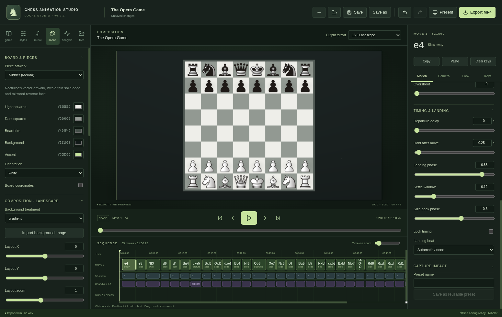

# Chess Animation Studio · 0.1.0

A local desktop editor for chess videos. Import a PGN/FEN, play an animated first draft, refine individual moves, align landings to music, and render an MP4. Built with Electron, React, TypeScript, Three.js, chess.js, and FFmpeg.

**This is an initial implementation, not a claim that every release acceptance check has passed on Windows.** See [validation and remaining work](docs/VALIDATION.md). The full [product brief](docs/PRODUCT_BRIEF.md) is retained.



## Run on Windows

If you use the supplied portable Windows archive, extract **all** of its files and launch `Chess Animation Studio.exe`. Node.js and Git are not needed for that prebuilt app. Configure FFmpeg (and optional Stockfish) in Settings using the download guidance below.

To run from source:

1. Install **Node.js 24 LTS** (includes npm) from [nodejs.org](https://nodejs.org/). Git is only needed to clone the source.
2. Install a trusted Windows **FFmpeg** build containing `libx264` and AAC, following the Windows links on [ffmpeg.org/download.html](https://ffmpeg.org/download.html). Extract it locally. You can add its `bin` directory to PATH or choose `ffmpeg.exe` in the app’s Settings.
3. For optional engine suggestions, download a compatible Windows x64 **Stockfish** build from [stockfishchess.org/download](https://stockfishchess.org/download/). Keep its accompanying files/NNUE networks together. Choose the executable in Settings. Analysis is optional; playback/export work without it.
4. In a terminal in this checkout:

   ```powershell
   npm ci
   npm run build
   npm start
   ```

For live development, run `npm run dev` instead. Everything except online Masters lookups works offline after dependencies and local tools are installed. No accounts or cloud storage are used.

If a corporate/cloud environment requires an HTTP proxy for Electron’s binary download, set its supported `ELECTRON_GET_USE_PROXY=1` option while preserving the supplied proxy and CA trust. Do not turn off TLS verification.

## Build a Windows installer

```powershell
npm ci
npm run package:win
```

On a successful native build, the unsigned x64 NSIS installer is written under `release/`. The supplied local artifact is a portable Windows ZIP; Linux NSIS helper generation remained blocked by WoW64 and no incomplete installer is included. Installation supports choosing a destination and creating a desktop shortcut. The app intentionally **does not bundle FFmpeg or Stockfish**; configure their executables once in Settings. No code-signing identity has been configured. Windows installation, AMD GPU rendering/encoding, OBS capture, and Resolve import still need testing on Windows; a Linux cross-build alone does not verify them.

## Try the sample

Choose **Game → Open sample with original music**. It loads the 33-ply Opera Game, including a thin-edge knight spin, a dramatic landing, capture growth/glow, a manual brilliant badge, corrected/selected beat markers, subtle snow, and an original synthesized pulse track. The synthesized sounds are original; the Cburnett and Nibbler/Merida piece artwork is distributed under its own GPL terms. See docs/piece-licenses.

- [Sample project](samples/Opera-Game.castudio)
- [Short user guide](docs/USER_GUIDE.md)
- [Project and architecture notes](docs/ARCHITECTURE.md)
- [Analysis, asset licensing, and platform guidance](docs/SOURCES.md)
- [Third-party notices](docs/THIRD_PARTY.md)
- [Reference-recipe template](docs/references/TEMPLATE.md)

## Validate

```powershell
npm run build
npm test
npm run test:desktop
```

The desktop integration runner needs a display, FFmpeg/ffprobe, and a local Stockfish. Set `STOCKFISH_PATH`, `FFMPEG_PATH`, and `FFPROBE_PATH` to their full paths if they are not on PATH. On Linux a display such as Xvfb can be used (`DISPLAY=:99`). The test-only Electron launch uses SwiftShader and sandbox exceptions for isolated headless testing; normal app launches do not add these flags. Unit/integration tests report missing optional native tools as skipped; they do not establish export readiness in that case.

`npm run sample` regenerates the example project and its original WAV. The desktop runner creates actual MP4s, screenshots, probe reports, and a test summary in ignored `test-results/`. It uses browser automation **only for testing**; the application and export never require it.

Version changes belong in `package.json`, `package-lock.json`, and `src/core/model.ts`; bump them together for updated builds.
