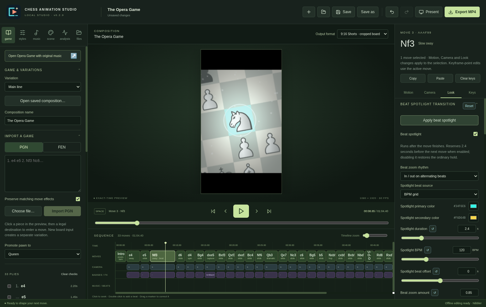

# Chess Animation Studio · 0.2.10

A local desktop studio for animated chess videos. Import a game, shape each move, align landings to music, and render MP4 directly. This is a fresh implementation on the `fresh-start` branch; the earlier implementation and downloads are preserved.

## Windows downloads

**[Download 0.2.10 for Windows (unsigned application, x64)](https://github.com/understandingothers789-pixel/Chess-Animation-Studio/releases/download/studio-v0.2.10/Chess-Animation-Studio-0.2.10-Windows-Portable.zip).** Adds playhead snapping to move boundaries with an optional toggle and Alt bypass. Standard **9:16 Vertical** framing now centers the board and uses the available width; the default camera stays settled through the intro into the first move. Windows packaging and app validation are running; download will be available when the release completes.

**[Download 0.2.9 for Windows (unsigned application, x64)](https://github.com/understandingothers789-pixel/Chess-Animation-Studio/releases/download/studio-v0.2.9/Chess-Animation-Studio-0.2.9-Windows-Portable.zip).** Adds cropped **9:16 Shorts** framing, captured pieces that crumble into artwork-colored dust, optional per-move red/colored light flicker, and a **Beat spotlight transition** with music-marker/BPM zoom rhythms, camera rocking, neon glow, sparkles, color changes and zoom blur. Includes selected-move editing, resets, tooltips and reversible automatic spotlight holds. All 26 tests and native Windows packaged editing, dust/light/spotlight, presentation and export checks passed. Published ZIP SHA-256: `2d9643cca0df3cfd5a003e0149bb1434678f85c18e6724d0e5d9984899dad711`.

**[Download 0.2.8 for Windows (unsigned application, x64)](https://github.com/understandingothers789-pixel/Chess-Animation-Studio/releases/download/studio-v0.2.8/Chess-Animation-Studio-0.2.8-Windows-Portable.zip).** Sets the requested default board colors to **brown #B88762** (dark squares) and **beige #EDD6B0** (light squares). Adds explanatory hover tooltips and accessible descriptions across all setting inputs, including units and numeric ranges. New compositions and Board & pieces reset use the palette; saved custom board colors stay intact. All 16 tests and native Windows palette/tooltip, editing and export checks passed. Published ZIP SHA-256: `5ec5ec999c0ae3643cf313c41355cdb7c1f73488169b42442e913556f0cb58e0`.

**[Download 0.2.7 for Windows (unsigned application, x64)](https://github.com/understandingothers789-pixel/Chess-Animation-Studio/releases/download/studio-v0.2.7/Chess-Animation-Studio-0.2.7-Windows-Portable.zip).** Replaces the knight logo with a cyan frame, coral play symbol and cream spark in the editor, favicon and running window icon. Adds **Reset** beside effect sections and individual **↺** buttons for snow, board-effect and move-motion numeric settings. Resets are undoable and selected moves restore their own preset defaults. Built and tested natively on Windows: 16 tests plus packaged logo/reset/Undo checks and all export-format checks passed. Published ZIP SHA-256: `a06e9fb93584ac8de3f1493962ba4edff36ab7587e28fea1b9ba7f80b3d35518`.

**[Download 0.2.6 for Windows (unsigned application, x64)](https://github.com/understandingothers789-pixel/Chess-Animation-Studio/releases/download/studio-v0.2.6/Chess-Animation-Studio-0.2.6-Windows-Portable.zip).** Adds a clickable **Intro** clip before the first move with four selectable openers and editable timing/framing. Fixes inspector preset and motion changes to affect **every selected move**, including Half sway. Snow stays inside the board by default, with an optional full-scene toggle; amount, size, transparency and speed controls now appear first in **Scene**. Includes a [free funk music recommendation and import guide](docs/USER_GUIDE.md#free-funk-track-for-music-testing). Built and tested natively on Windows: 16 tests plus packaged editing, launch, save/open, all export formats, cancellation and presentation passed. Published ZIP SHA-256: `4e9708e7f9e1b16f889c8b061fa7c2afd4e78f368a54c25759641cda607e4c3b`.

**[Download 0.2.5 for Windows (unsigned application, x64)](https://github.com/understandingothers789-pixel/Chess-Animation-Studio/releases/download/studio-v0.2.5/Chess-Animation-Studio-0.2.5-Windows-Portable.zip).** Adds subtle always-lit shimmer, a configurable zoom-and-turn intro, first-move Slow sway, and dark-square tempo color pulses. Also adds breathing rim light, traveling light sweep and vignette breathing. Adjust strength, speed, color and intro timing in **Scene → Board atmosphere & intro**. Built and tested natively on Windows: 15 tests plus packaged launch, save/open, all export formats, cancellation and presentation passed. Published ZIP SHA-256: `05ec358be31ef6dedfb261e00769f4b835a7ba21196f74e2503a76e2ca50ca2b`.

**[Download 0.2.4 for Windows (unsigned application, x64)](https://github.com/understandingothers789-pixel/Chess-Animation-Studio/releases/download/studio-v0.2.4/Chess-Animation-Studio-0.2.4-Windows-Portable.zip).** Makes ambient snow visible with larger editable flakes and prevents camera culling. Adds a smooth one-sided Half sway, Ctrl/Shift move selection in the list and timeline, an explicit apply-to-all/default action, and a sharp contour reconstruction of the Neo reference pieces. The Neo references are 140px PNGs; reconstructed artwork is not claimed pixel-identical to high-resolution originals. Built and tested natively on Windows: 14 tests plus packaged launch, save/open, all export formats, cancellation and presentation passed. Published ZIP SHA-256: `d0b06d630d35743e66aa6e4adcca6c445b8904eaa43a4ce5d9050aef909bfe00`.

**[Download 0.2.3 for Windows (unsigned application, x64)](https://github.com/understandingothers789-pixel/Chess-Animation-Studio/releases/download/studio-v0.2.3/Chess-Animation-Studio-0.2.3-Windows-Portable.zip).** Final fresh implementation with Nocturne's vector artwork and solid edges, slow sway, full local editor, audio/beat editing, analysis, recovery and direct export. Isolates new recovery/settings data from the older app, validates a fresh ZIP in a path with spaces, and identifies the presentation window explicitly during validation. Includes the recovery and engine lifecycle safeguards developed in checkpoint 0.2.2. Built and tested natively on Windows from a fresh ZIP extraction in a path with spaces: 13 core/service tests and packaged launch/export checks passed. The published download was independently downloaded and checksum/CRC checked. ZIP SHA-256: `1754d9dd3e392bbbc9f940825f85c33cf9dfac6be7a1e2c9f8b958764709982c`. See [validation](docs/VALIDATION.md) for evidence and Windows policy limitations.

**[Download 0.2.1 for Windows (unsigned application, x64)](https://github.com/understandingothers789-pixel/Chess-Animation-Studio/actions/runs/41019103040/artifacts/12961316388).** Fresh editor with Nocturne's Nibbler/Merida and Lichess/Cburnett vector artwork, traced thin solid edges, slow sway, per-move camera/effect controls, numeric keyframes, music and editable beat markers, local analysis, recovery, clean presentation, and exact-time MP4 export. Uses a standard portable folder built on Windows, with the official Electron runtime copied unchanged. No split-file assembly or PowerShell launcher is needed. Check the [release validation record](docs/VALIDATION.md) for actual results and limitations. Windows Application Control approval is not guaranteed.

The current [workflow artifact](https://github.com/understandingothers789-pixel/Chess-Animation-Studio/actions/runs/41020652349/artifacts/12961951026) is an alternate download. If needed, open the [Windows build runs](https://github.com/understandingothers789-pixel/Chess-Animation-Studio/actions/workflows/windows.yml?query=branch%3Afresh-start) and choose a **successful** run. Its `Chess-Animation-Studio-0.2.3-Windows-Portable` artifact has the version in the downloaded ZIP filename. Workflow artifacts require a GitHub login and expire after 90 days; release assets are the persistent download when publication succeeds.

**[Download 0.2.0 for Windows (unsigned application, x64)](https://github.com/understandingothers789-pixel/Chess-Animation-Studio/actions/runs/41017597591/artifacts/12960905632).** First native Windows checkpoint of the fresh implementation. Packaged launch and export checks passed. Superseded by 0.2.1, which fixes audio/image asset loading, new-project save paths and asset cache refreshes. Workflow download requires GitHub login and is subject to retention.

**[Download 0.1.7 for Windows (unsigned, x64)](https://github.com/understandingothers789-pixel/Chess-Animation-Studio/archive/refs/tags/windows-v0.1.7.zip).** Prior implementation: restored the original drawn pieces and retained slow sway. The user reported Windows Application Control blocked this build.

**[Download 0.1.6 for Windows (unsigned, x64)](https://github.com/understandingothers789-pixel/Chess-Animation-Studio/archive/refs/tags/windows-v0.1.6.zip).** Prior implementation: replaced the fast wiggle with slow sway. Includes Nocturne vector artwork. The user reported an executable signing-policy block.

**[Download 0.1.5 for Windows (unsigned, x64)](https://github.com/understandingothers789-pixel/Chess-Animation-Studio/archive/refs/tags/windows-v0.1.5.zip).** Prior implementation: restored the original two-file portable launcher with absolute paths; retained Nocturne artwork. Windows launch evidence for this exact artifact was not established.

**[Download initial 0.1.0 portable build](https://github.com/understandingothers789-pixel/Chess-Animation-Studio/archive/refs/tags/portable-v0.1.0.zip).** Earlier desktop editor. A user screenshot shows an application labeled 0.1.0 running; early builds reused that number, so the exact executable must be identified before a binary comparison.

## Open the portable app

1. Extract **all** files from the versioned Windows ZIP.
2. Double-click **Chess Animation Studio.exe**. Keep its companion files and folders together.
3. In the **Files** tab, choose your local `ffmpeg.exe` to enable MP4 export. Download Windows builds through [FFmpeg's official download page](https://ffmpeg.org/download.html).
4. Optionally choose a local Stockfish executable from [Stockfish's official download page](https://stockfishchess.org/download/).

No Node.js, npm, compiler, or source build is required to use the portable app. No encoder or engine executable is bundled. Open the Opera Game sample to try original synthesized music, corrected landing markers, sway, a thin-edge spin and capture glow.

The runtime and application are unsigned. The native workflow records `Get-AuthenticodeSignature` results and verifies the runtime executable is byte-for-byte unchanged. It does not disable Windows security, remove download metadata, or modify application-control policies. Passing the workflow's Windows launch check does not establish Smart App Control approval on your PC.

## Editing

- **Game:** import PGN/FEN, select a variation, check moves for batch edits, or enter legal moves in the preview.
- **Styles:** apply a preset to one move, checked moves, or the whole game. Save your own preset in the Motion inspector.
- **Motion / Camera / Look / Keys:** refine the selected move, including normalized keyframes and framing per output format.
- **Music:** import music, analyze transients, correct markers, preview timing arrangements, and assign local sound cues.
- **Scene:** select sharp artwork, adjust board colors, atmosphere, dark-square pulses and per-format layout.
- **Analysis:** suggest opening-book and engine badges. Manual badges always take priority.
- **Files:** configure tools and optional credentials, collect a portable project, relink assets, open logs and recent projects.

See the [user guide](docs/USER_GUIDE.md), [architecture](docs/ARCHITECTURE.md), [sources and licensing](docs/SOURCES.md), and [known limits](docs/VALIDATION.md).

## Build from source

For development only: Node.js **24.19.0**, `npm ci`, `npm run build`, then `npm start`. `npm run dev` starts the local Vite editor. `npm test` runs core and service checks; FFmpeg is required for export checks. Configure `STOCKFISH_PATH` to include a real-engine check.

`npm run portable` on Windows creates `release/Chess-Animation-Studio-VERSION-Windows-Portable.zip`, its SHA-256 file, runtime-signature evidence, and `BUILD.json` in the app folder. The packager refuses to overwrite an existing versioned folder. `npm run test:desktop` exercises the actual Electron app and export pipeline; `STUDIO_PACKAGED_EXE` targets the packaged application.

The [Windows workflow](.github/workflows/windows.yml) runs these steps natively and publishes versioned downloads. `BUILD.json` records the source commit, clean/dirty state, Node and Electron versions, build platform, and executable hash. The stock runtime host retains Electron's executable metadata; the app's version is recorded in its window title, editor, package manifest, build manifest, archive and release notes.

## Scope

Core chess editing and deterministic export are implemented. Elaborate portals, cinematic cutaways, character faces, prop attachments, reload actions and imported animated scenes remain later features. They have no placeholder controls in the editor. Project schema 2 reserves a scene extension and rejects unsupported nonempty scene data.

The app and the Cburnett/Merida piece assets are distributed under GPL terms; Neo source artwork retains its original ownership and is not relicensed by the application; see [LICENSE](LICENSE) and [asset notices](docs/licenses). No official Chess.com badge pack, creator video clips, copyrighted songs, Stockfish binary or FFmpeg encoder executable is distributed. Neo piece provenance is documented in SOURCES.md.
