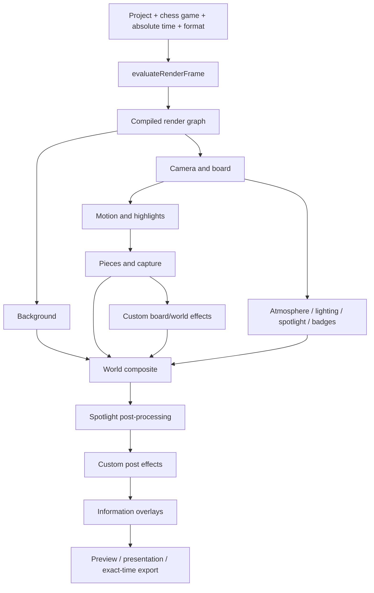

# Rendering engine and effect graph

`Scene` is the public API used by editor preview, presentation, and video export. It owns the WebGL context, assets, game cache, readback buffer, and compiled graph. It no longer implements board drawing, piece motion, dust, shaders, or canvas graphics. `engine/frame.ts` evaluates an absolute-time render frame before GPU work. Persistent projects are never modified by this evaluation.



## Ownership

| System | Owns | Borrows |
| --- | --- | --- |
| Background | Gradient shader, persistent aspect-correct image quad | Uploaded image textures |
| Board | Rim, squares, coordinate label textures | World root |
| Camera | Orthographic camera, projection/framing updates | World root and evaluated frame |
| Pieces | Templates and instance materials, shadows, artwork lease | Immutable shared artwork geometry/texture |
| Motion | Highlight squares and dynamic ribbon buffer | Evaluated trajectories and game |
| Capture | Halo, batched impact and dust buffers/materials | Template artwork samples and camera |
| Atmosphere | Batched snow buffer/material | Camera and evaluated clock |
| Lighting | Directional/ambient lights, screen tint shader | Evaluated light state |
| Spotlight | Tile/glow/ring, sparkle buffer, framebuffer copy and post shader | Camera and composed scene color |
| Overlays | Badge textures/materials, title/evaluation canvas | Uploaded badge images and evaluated game |

Each system releases local resources through its graph disposal hook. Shared artwork is reference counted across renderer instances, including asynchronous preparation. Late asset uploads are discarded after replacement/removal/disposal. Piece instances from unrelated games are pruned without disposing borrowed geometry. Disposal is idempotent at the graph/facade boundary; rendering afterward throws.

## Graph contract

`RenderGraph<C>` compiles stage order, explicit before/after edges, named output/input dependencies, and stable priority/declaration order once. Duplicate IDs, missing dependencies/inputs, duplicate producers, cycles (including disabled nodes), invalid intervals, and invalid priorities are rejected. Optional `initialize`, `resize`, `active`, and `dispose` hooks support expensive effects without requiring boilerplate from simple passes. Time intervals use inclusive start/exclusive end. Disabled/inactive nodes do no render work. Legacy named inputs/outputs remain ordering constraints; typed runtime resources below provide explicit availability and lifetime guarantees.

The stages are `background → board → world → post → overlay`. `world` is reserved in `Scene` for the actual framebuffer draw: extension declarations using it are rejected. Every `board` extension runs before that draw, regardless of where it appears in the registration array. Every `post` pass sees the completed world draw; all overlays follow all post passes. Within a stage, dependency edges override priority, followed by stable declaration order. A backward dependency across stages is rejected as a conflicting stage order. The graph is never sorted per frame.

Initialization records each pass before invoking its hook, so partially initialized passes are included in rollback. Every cleanup is attempted in reverse order; an `AggregateError` retains the initialization error as its cause and cleanup errors as diagnostics. Scene and graph share once-only core disposal callbacks. Normal disposal is idempotent and continues through errors. After a failed resize, dimensions remain invalid and every hook is retried on the next draw, including a return to the previous size. Resize hooks must be repeatable. Render/resource failures are never cached.

The facade restores render target/cube face/mip, viewport, scissor/test, clear color/alpha, auto-clear, tone mapping/exposure, output color space and root visibility in `finally`, and resets Three.js state caches (including depth/stencil). Readback temporarily selects the default framebuffer and restores the previous target. Extensions must restore arbitrary scene mutations and additional renderer settings they modify; the API does not snapshot every Three.js object or external WebGL object.

## Runtime resources versus ordering

Legacy string `inputs`/`outputs` and `before`/`after` remain **ordering only**, preserving inactive-producer behavior. New code needing actual data uses tokens from `engine/RuntimeResources.ts`:

```ts
import { resource } from '../src/render/engine/RuntimeResources';
import { RenderGraph } from '../src/render/engine/RenderGraph';
const luminance = resource<number>('luminance');
const graph = new RenderGraph<null>([
  { id: 'measure', stage: 'post', provides: [luminance],
    render: (_, resources) => resources.publish(luminance, 0.5) },
  { id: 'consume', stage: 'post', requires: [{ key: luminance }],
    render: (_, resources) => console.log(resources.read(luminance)) },
]);
```

Tokens carry value types and are shared by identity. Duplicate producers/names and missing required producers are graph-compilation errors. A missing current-frame value (including an inactive producer) throws before a required consumer renders. `{ key, optional: true }` permits absence and returns `undefined`; `{ key, fallback: () => value }` provides a borrowed fallback when read. Optional/fallback consumers may have no producer. A read/write must be declared by that pass. Ordering constraints never imply runtime availability.

Default tokens expire after each draw, including failed draws and backward seeks. `resource<T>('name', 'graph')` explicitly retains the last successfully committed value across frames and inactive producers. Failed-frame replacements are discarded. A publish release callback transfers ownership to the registry; omitted callbacks mean borrowed values. Frame values are released after drawing; graph values on replacement/disposal. Every release is attempted even if another throws. Pass-owned GPU objects may instead be borrowed through the registry and disposed by the pass. Do not publish the same owned object repeatedly with independent release callbacks. Fallback factories must return borrowed values and should be pure.

## Add a world effect

```ts
import * as T from 'three';
import { Scene } from '../src/render/Scene';
const scene = new Scene(canvas, ({ root }) => {
  let mesh: T.Mesh<T.SphereGeometry, T.MeshBasicMaterial>;
  return [{
    id: 'contact-orbit', stage: 'board', after: ['pieces'],
    initialize: () => {
      mesh = new T.Mesh(new T.SphereGeometry(0.1), new T.MeshBasicMaterial({ color: '#ffff00' }));
      root.add(mesh);
    },
    render: frame => mesh.position.set(Math.sin(frame.time), 0, 1),
    dispose: () => { if (mesh) { root.remove(mesh); mesh.geometry.dispose(); mesh.material.dispose(); } },
  }];
});
```

Allocate inside `initialize`, rather than the factory, so a structurally invalid graph does not leak factory-created resources. Cleanup must tolerate partial initialization. Use absolute time and deterministic seeds; never mutate persistent projects or accumulate movement per draw.

## Add a screen effect

This simple post effect draws a translucent screen tint before information overlays:

```ts
import * as T from 'three';
import { Scene } from '../src/render/Scene';
let tint = '#204060';
let requestRedraw = () => {};
const scene = new Scene(canvas, ({ renderer, invalidate }) => {
  requestRedraw = invalidate;
  const screen = new T.Scene();
  const camera = new T.OrthographicCamera(-1, 1, 1, -1, 0.1, 10);
  camera.position.z = 2;
  let quad: T.Mesh<T.PlaneGeometry, T.MeshBasicMaterial>;
  return [{
    id: 'screen-tint', stage: 'post', inputs: ['scene-color'],
    initialize: () => {
      quad = new T.Mesh(new T.PlaneGeometry(2, 2), new T.MeshBasicMaterial({
        color: tint, opacity: 0.1, transparent: true, depthTest: false, depthWrite: false,
      }));
      screen.add(quad);
    },
    render: () => { quad.material.color.set(tint); renderer.render(screen, camera); },
    dispose: () => { if (quad) { quad.geometry.dispose(); quad.material.dispose(); } },
  }];
});
tint = '#602040';
requestRedraw(); // The next render of an otherwise identical paused frame redraws.
```

`Scene.invalidate()` and the factory service `invalidate()` increment a local revision. Call one when external effect settings, assets or activation predicates change. Use an `active` closure for external enable/disable state; structural declarations are compiled once. Unchanged frames stay cached. Invalidations raised during a render survive into the next frame. The host calls `render` again; preview already polls through requestAnimationFrame.

## Assets and readiness

`assetState(id)` distinguishes loading, ready and failed; absence means unloaded. `setAsset(id, url)` deduplicates loading/ready requests and retries failed requests on the next call. Failure retains the last valid texture but rejects the request. Preview retries when asset props/readiness are reconciled; presentation retries on the next state update. There is no automatic infinite retry loop or backoff. A superseded/removal/disposal request cannot commit even when its network operation cannot be physically cancelled; its eventual texture is released. Stale failures do not replace the newer state.

`prepareAssets(urls)` waits for all expected assets and verifies their current selected URLs are ready. Export uses it before the first frame; failure is reported to native export cleanup instead of silently drawing missing images. Successful assets invalidate the frame cache. Shared piece artwork uses separate reference-counted leases; failed promise-cache entries are evicted, and disposed preparation stops before requesting additional artwork.

## Compiled timeline and overlay caching

`compileTimeline(project)` uses a WeakMap of immutable project identities to frozen segments and total duration. Scene frame evaluation, capture accents and motion highlights reuse the same metadata. Undo/redo reuses the retained project revision safely; obsolete projects are collectable. `segments()` and ordinary `evaluate()` remain available for mutable authoring utilities; rendering requires immutable revisions. Capture-event scanning remains linear and has not been replaced speculatively.

Title repainting keys the actual normalized animation phase and alpha. Once the flight/impact/opacity settle, identical title pixels reuse the full-resolution texture until the fade begins. Static evaluation content remains cached by project/index/size. Animated title frames still use the original full-resolution canvas to preserve exact rasterization.

## Cinematic accents and compatibility

The existing timeline remains authoritative for moves, easing, keyframes, motion trails, camera curves, capture dust, beat spotlight and atmosphere. All supported project assets and four output formats are retained. No schema version bump is required: old captures gain neutral `cameraShake: 0` and `impactLight: 0` defaults through the existing Zod migration.

The Capture impact panel exposes these two optional accents. A pure absolute-time contact cue coordinates the damped camera tremor and short colored light pulse. Only actual captures trigger them. Their amplitude decays to zero within 0.35 seconds, so backward seeks reconstruct exactly. The strongest active light accent wins over weaker move/spotlight lighting; light values are not accumulated across frames. Existing growth, dust, glow, particles, and settling remain on the same move clock.

## Allocation and performance decisions

- Pass dependency sorting occurs at graph construction, rather than per rendered frame.
- Background images reuse one quad and material; aspect changes update only transforms.
- Motion trails reuse a dynamic position/index buffer, growing capacity only when necessary.
- Radial textures are shared within each owning system and explicitly released.
- Generated badges release replaced textures; unchanged evaluation overlays avoid repaint/upload.
- Disabled snow skips particle evaluation; active particles update preallocated typed buffers.
- Identical immutable project/time/size/format inputs reuse the last successful draw; asset readiness/changes invalidate it. This removes redundant paused-preview work without accumulating animation state.
- Readback reuses its GPU-read scratch buffer while returning a distinct, safe output buffer per IPC frame.

These are allocation/lifecycle improvements, not measured FPS claims. Software-rendered regressions do not establish native Windows or physical GPU performance. Quality tiers, bloom, temporal motion blur and GPU particle simulation are future extensions, not implemented features.

See `RENDER_OVERHAUL_VALIDATION.md` for exact executed checks and limits.

## Phase II validity, cleanup and recovery contracts

Resource lifetime now accepts `frame`, `project`, or `graph`. `resource<T>('name', 'project')` persists across frames/backward seeks within one immutable project. Scene supplies project identity to `RenderGraph.render(..., project)`. On a project transition, project resources are removed and released before passes run; returning to an old project does not resurrect its old resources. Graph resources remain intentionally reusable across projects. Standalone graph users must supply a scope identity before producing project resources.

`scene.invalidateResource(key)` or the equivalent factory service releases that resource and invalidates the paused frame. Omit the key to invalidate all persistent values. Call outside rendering; invalidation during an active resource frame is rejected. Project transitions and invalidations remove ownership before cleanup, so throwing callbacks are never retried implicitly.

Successful frames commit persistent replacements **before** attempting obsolete-resource cleanup. Cleanup failure throws an AggregateError with `committed: true`; the replacement remains available to the next frame. Failed draws discard pending values and keep previously committed values, reporting cleanup failures with `committed: false`. GPU release is not reversible. Disposers are marked attempted before invocation, all other disposers still run, and normal graph disposal releases every remaining value once. Republishing the same owned object under its token retains its original release callback. Multiple owned tokens for the same object, owning a previously released object, or replacing an owned object with a borrow are rejected. Borrowing elsewhere does not transfer ownership; extensions must respect the owner's lifetime. Physical aliasing inside wrapper objects cannot be proven by TypeScript.

Preview and presentation request up to two retries at 250 ms and 500 ms. Loading and backoff share one promise, so callers do not duplicate requests. Replacement/removal/disposal cancels scheduled retries; in-flight obsolete requests may finish but cannot commit. Invalid data URLs are not automatically retried; custom callers can supply a `retryable` predicate. Preview displays **Retry images** after final failure. Export preparation does not silently accept a retained older texture. Once a replacement is installed, old-texture disposal failure is recorded in `assetState(id).cleanupError`; readiness and the successful request promise remain consistent.

Scene detects actual `webglcontextlost` events and synchronous `isContextLost()` before render/cache reuse or readback. It fails clearly rather than returning a stale frame or exporting invalid bytes. Preview stops drawing and offers **Reload graphics**; this constructs a fresh Scene and re-prepares assets from the retained immutable editor state. Even if Three.js restores its own context automatically, Scene requires recreation because extensions may own raw GPU objects that cannot be revived safely. Constructor failures also expose the reload action. Driver-level and whole Electron graphics-process recovery remain separate limitations. The WebGL extension simulation tests loss and subsequent new-scene operation; it does not establish real driver recovery.

`renderer.resetState()` is retained. The measured software-renderer cost was small relative to frame work and cannot justify weakening failure recovery. See the Phase II report for exact measurements and coverage.
