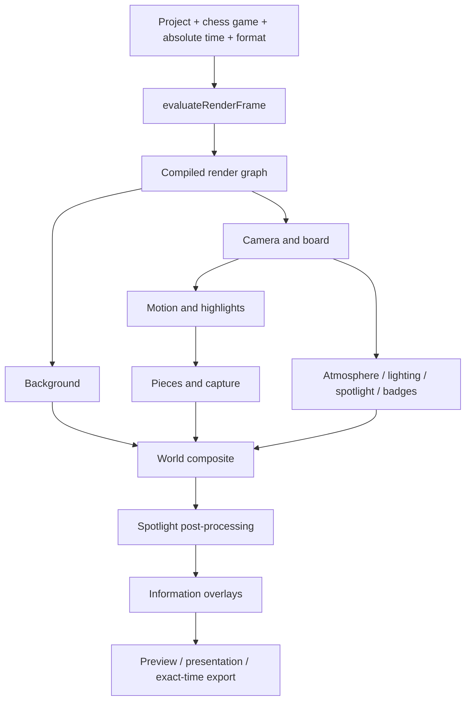

# Rendering engine and effect graph

`Scene` is the public API used by editor preview, presentation, and video export. It owns the WebGL context, assets, game cache, readback buffer, and compiled graph. It no longer implements board drawing, piece motion, dust, shaders, or canvas graphics. `engine/frame.ts` evaluates an absolute-time render frame before GPU work. Persistent projects are never modified by this evaluation.



## Ownership

| System | Owns | Borrows |
| --- | --- | --- |
| Background | Gradient shader, persistent aspect-correct image quad | Uploaded image textures |
| Board | Rim, squares, coordinate label textures | World root |
| Camera | Orthographic camera, projection/framing updates | World root and evaluated frame |
| Pieces | Templates and instance materials, shadows, artwork lease | Immutable shared artwork geometry/texture |
| Motion | Highlight squares and dynamic ribbon buffer | Evaluated trajectories and game |
| Capture | Halo, batched impact and dust buffers/materials | Template artwork samples and camera |
| Atmosphere | Batched snow buffer/material | Camera and evaluated clock |
| Lighting | Directional/ambient lights, screen tint shader | Evaluated light state |
| Spotlight | Tile/glow/ring, sparkle buffer, framebuffer copy and post shader | Camera and composed scene color |
| Overlays | Badge textures/materials, title/evaluation canvas | Uploaded badge images and evaluated game |

Each system releases local resources through its graph disposal hook. Shared artwork is reference counted across renderer instances, including asynchronous preparation. Late asset uploads are discarded after replacement/removal/disposal. Piece instances from unrelated games are pruned without disposing borrowed geometry. Disposal is idempotent at the graph/facade boundary; rendering afterward throws.

## Graph contract

`RenderGraph<C>` compiles stage order, explicit before/after edges, named output/input dependencies, and stable priority/declaration order once. Duplicate IDs, missing dependencies/inputs, duplicate producers, cycles (including disabled nodes), invalid intervals, and invalid priorities are rejected. Optional `initialize`, `resize`, `active`, and `dispose` hooks support expensive effects without requiring boilerplate from simple passes. Time intervals use inclusive start/exclusive end. Disabled/inactive nodes do no render work. As in the legacy scheduler, an inactive producer is an ordering relationship only; consumers needing its computed data must explicitly gate activation or supply a fallback.

The fixed stages are background, board, post, overlay. Within the board stage, camera, board, motion, pieces and capture dependencies are explicit; the world draw waits for all visual updates. Existing depth, stencil, color-space, scissor and viewport semantics are preserved. The facade restores viewport, scissor and root visibility even if a pass throws. Extensions must restore any additional renderer state they change. The spotlight buffer is resized lazily only when its effect runs; no offscreen copy is performed for an inactive post effect.

## Add an effect

Create an independent module with the resources and evaluation it needs, then provide a `Pass<RenderFrame>` to the optional second `Scene` constructor argument. There is no effect-ID switch in `Scene`.

```ts
const scene = new Scene(canvas, ({ renderer, camera }) => {
  const effect = new MyColorEffect(renderer, camera);
  return [{
  id: 'my-color-effect',
  stage: 'post',
  inputs: ['scene-color'],
  initialize: () => effect.initialize(),
  resize: (w, h) => effect.resize(w, h),
  active: frame => frame.time >= 2 && frame.time < 4,
  render: frame => effect.render(frame),
  dispose: () => effect.dispose(),
}];
});
```

The registered pass must own its buffers and restore any state it changes. Use absolute frame time and deterministic seeds. Never read wall-clock time, accumulate movement per rendered frame, or mutate persistent project settings. If a new system owns another module's resources, document that transfer explicitly.

## Cinematic accents and compatibility

The existing timeline remains authoritative for moves, easing, keyframes, motion trails, camera curves, capture dust, beat spotlight and atmosphere. All supported project assets and four output formats are retained. No schema version bump is required: old captures gain neutral `cameraShake: 0` and `impactLight: 0` defaults through the existing Zod migration.

The Capture impact panel exposes these two optional accents. A pure absolute-time contact cue coordinates the damped camera tremor and short colored light pulse. Only actual captures trigger them. Their amplitude decays to zero within 0.35 seconds, so backward seeks reconstruct exactly. The strongest active light accent wins over weaker move/spotlight lighting; light values are not accumulated across frames. Existing growth, dust, glow, particles, and settling remain on the same move clock.

## Allocation and performance decisions

- Pass dependency sorting occurs at graph construction, rather than per rendered frame.
- Background images reuse one quad and material; aspect changes update only transforms.
- Motion trails reuse a dynamic position/index buffer, growing capacity only when necessary.
- Radial textures are shared within each owning system and explicitly released.
- Generated badges release replaced textures; unchanged evaluation overlays avoid repaint/upload.
- Disabled snow skips particle evaluation; active particles update preallocated typed buffers.
- Identical immutable project/time/size/format inputs reuse the last successful draw; asset readiness/changes invalidate it. This removes redundant paused-preview work without accumulating animation state.
- Readback reuses its GPU-read scratch buffer while returning a distinct, safe output buffer per IPC frame.

These are allocation/lifecycle improvements, not measured FPS claims. Software-rendered regressions do not establish native Windows or physical GPU performance. Quality tiers, bloom, temporal motion blur and GPU particle simulation are future extensions, not implemented features.

See `RENDER_OVERHAUL_VALIDATION.md` for exact executed checks and limits.
