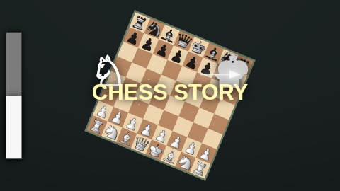
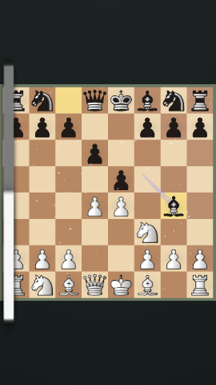

# Rendering overhaul — execution and validation report

## Result and scope

The experimental engine replaces the 1,220-line monolithic renderer with a small public facade and ten owned rendering systems. A compiled render graph orchestrates the full frame, not just the final two effects. Pure frame evaluation reuses the existing chess/timeline engine. Preview, scrubbing, presentation and exact-time export use the same `Scene` API.

The implementation includes named pass inputs/outputs, stage/dependency validation, stable ordering, activation intervals/predicates, synchronous initialization, resize hooks, failure cleanup and reverse disposal. New effect factories receive explicit rendering services. Graph errors identify the failed pass. Invalid times, dimensions, GPU limits and use after disposal are rejected.

## Branch boundary

Repository: `understandingothers789-pixel/Chess-Animation-Studio`.
All implementation commits belong to `architecture/effect-compositor`.
Both the original experimental tip and protected `studio-main` tip were `9e2eccc56e228fee5b526c9fc097316400c2ab08`.

Other original protected heads:

- `main`: `e4ce9a7c61c250c6e1f84707d643da5942ea4cf7`
- `fresh-start`: `5030ba80ff8444b312d775257319b594bf9b3fba`
- `windows-download`: `6c185b473c2f4d855eb42517d1f8367d4edc8319`

Only the experimental destination is pushed. The final tip and the remote comparison are verified after the final commit, in the task's Git report. No merge, force-push, branch rename or protected-branch commit is part of this task.

## Module layout

See [the graph diagram, module ownership and extension recipe](EFFECT_COMPOSITOR.md).

- `engine/RenderGraph.ts`: compiled scheduling and lifecycle.
- `engine/frame.ts`: pure absolute-time frame inputs, intro/framing and neutral-compatible capture accents.
- `engine/impact.ts`: a shared deterministic contact cue for optional shake and light pulse.
- `engine/resources.ts`: deduplicated ownership, shared radial and batched-particle infrastructure.
- `engine/coordinates.ts`: board/world conversions.
- `systems/`: background, camera, board, pieces, motion, capture, lighting, atmosphere, spotlight and overlays.

`Scene.ts` retains renderer creation, graph registration, asset sequencing, picking and RGBA readback. The old giant frame function and per-frame scene-image/trail rebuilding are gone. The temporary legacy fixture renderer was removed after comparisons; it is not a second production pipeline.

## Migrated behavior and additional effects

Existing piece art, board styling/orientation, coordinate labels, highlights, ribbon trails, capture growth/glow/particles/dust, snow, rainbow colors, board pulses, move lighting, spotlight shaders, evaluation bar and animated title are retained. Existing timeline curves, camera interpolation, normalized keyframes and deterministic particle evaluation remain authoritative.

Optional Capture camera shake and Capture light pulse are exposed in the existing Capture impact panel. They share the actual capture contact time, decay within 0.35 seconds, and default to zero. Existing projects retain their appearance through defaulted schema fields. The strongest light accent wins rather than accumulating state between frames. No unrelated editor redesign or piece-asset replacement was performed.

## Performance and lifecycle

The graph is compiled once. Image backgrounds reuse a quad/material; ribbon positions and indices reuse buffers; particle systems reuse typed arrays. Old badge textures and obsolete game instances are released. Piece artwork uses renderer leases so closing an exporter does not invalidate the editor. Late/replaced asset uploads are discarded safely. Readback reuses its scratch buffer and returns independent output arrays suitable for IPC.

Paused previews now reuse the last successful immutable project/time/format/size frame. Asset preparation and uploads invalidate that cache. A failed frame is never cached. Final browser checks verify the idle cache, independent PNG/RGBA output, initialization rollback, render failure recovery, double disposal, disposal guards and shared artwork surviving another renderer's disposal. After warmup, another 60 scrub frames show no increase in `renderer.info.memory`.

These results demonstrate allocation and lifecycle behavior. They are not FPS or physical-GPU benchmark claims. No physical-GPU speedup percentage was measured.

## Executed checks

Linux, Node 24.19.0, Electron 39.8.10, system Chromium with SwiftShader, FFmpeg/ffprobe, and Xvfb `DISPLAY=:99`.

| Check | Command | Result | Evidence |
| --- | --- | --- | --- |
| Baseline unit tests | `npm test` before migration | Pass | 34 tests |
| TypeScript | `npx tsc --noEmit` and build's type check | Pass | Final production source |
| Unit/integration tests | `npm test` | Pass | 41 tests, including graph, frame, chess, storage, Stockfish and FFmpeg |
| Production build | `npm run build` | Pass | TypeScript, Vite, Electron bundles |
| Electron desktop | `DISPLAY=:99 STOCKFISH_PATH=/workspace/tools/usr/games/stockfish npm run test:desktop` | Pass | [Actual runner output](render-overhaul/desktop-validation.txt) |
| Video export | Included in desktop runner | Pass | H.264/AAC 60 FPS; landscape plus native vertical, square and square-in-vertical; cancellation cleanup |
| Visual/lifecycle regression | `npm run test:render -- final` | Pass | 216 requests, 168 unique fixtures; exact repeated-time reconstruction and independent renderer/readback equality |
| Legacy image comparison | `python scripts/compare-render-fixtures.py test-results/render-full-baseline test-results/render-final` | Pass | [Per-fixture differences](render-overhaul/pixel-comparison.json); requires Pillow |
| Diff hygiene | `git diff --check` | Pass | No whitespace errors |
| Native Windows / physical GPU | Not executable on this Linux host | Unrun | Windows CI is triggered by the experimental push; its future outcome is not established here |

The desktop runner validates controls, tooltips, piece sets, backward seeking, reset/Undo, multi-move presets, save/open, exact-time exports, cancellation, flicker, beat spotlight, capture dust and presentation. Initial runs failed the flicker screenshot checks when fixed 100–200 ms waits captured frames before they had settled. The final runner awaits two animation frames before the same strict pixel assertions; no equality checks were removed or relaxed.

## Visual references and tolerance

References were captured from the original renderer before replacement. The expanded references use the original `9e2eccc` renderer with unchanged assets and migrated project defaults. They include starting positions, white/black moves, castling, en passant, promotion, backgrounds, titles, evaluation overlays, atmosphere, trails, spotlight, rotated/zoomed intro and all four formats. Repeated requests include `0, 5, 2, 8, 5, 1, 8`.

All 84 initial fixtures match exactly. Of 168 expanded fixtures, 160 match byte-for-byte. Eight images have small differences in translucent regions: at most 49 pixels and at most 4/255 per RGB channel. The explicit migration tolerance is <=4/255 channel error on <=0.05% of pixels. This threshold applies only to comparing different renderer implementations; repeated timestamps and independent renderer instances still require exact equality.




Reproduce a legacy comparison without changing branches:

```sh
# Save the reference before any candidate run. Do not overwrite it with new output.
git show 9e2eccc56e228fee5b526c9fc097316400c2ab08:src/render/Scene.ts > src/render/LegacyScene.ts
RENDER_LEGACY=1 npm run test:render -- reference
rm src/render/LegacyScene.ts
npm run test:render -- candidate
python scripts/compare-render-fixtures.py test-results/render-reference test-results/render-candidate
```

The harness defaults to `/usr/bin/chromium`, supports `CHROMIUM_PATH` and `RENDER_PORT`, and uses a blank browser page so the application does not compete with fixture rendering. Browser versions and GPU backends must match for reference/candidate comparisons.

## Compatibility and limitations

Public `Scene` calls, schema-2 projects, existing presets, assets and four formats remain supported. New capture fields default to zero. The frame cache assumes the editor's existing immutable project-update contract; extension effects must also depend on explicit frame inputs. Inactive named outputs provide ordering, not an automatically substituted data buffer: consumers must gate themselves or provide a fallback. Initialization hooks are synchronous; asynchronous assets use the facade's readiness and asset APIs.

The physical Windows/AMD GPU, Windows packaged executable, OBS and Resolve have not been tested here. No new public release asset or Windows signing claim is made. Application version remains 0.2.15 on this experimental branch. Quality tiers, bloom, temporal motion blur and shader-driven particles are future extensions, not completed effects.

## Five next improvements, ranked

1. Run native Windows/AMD capture, export and visual benchmarks using fixed scenes and retained reference artifacts.
2. Add explicit preview/export quality tiers that change visual cost without changing timing or chess state.
3. Move high-count particle evaluation to shaders if profiling shows CPU updates dominate.
4. Extend authored camera tracks and reusable cinematic presets through the shared timeline and schema.
5. Add pooled render-target post effects such as restrained bloom/color grading, with matching color-space regressions.
