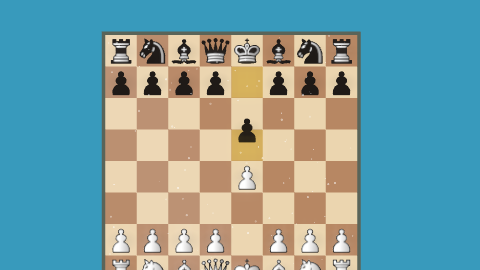

# Phase III: presentation recovery and selective cinematic bloom

## Source and scope

Work starts at `42375a8e70278ac45bfbadb9983e519dd1acd276` on `architecture/effect-compositor`, fetched before editing. This includes the two 0.2.18 build/link commits after the previously verified Phase II HEAD `9fcf3f54913ac1a27560a61e0db8e80abb998dd5`. Phase III keeps package version **0.2.18**, schema 2, historical releases, and all other branches unchanged. It does not dispatch publication, create tags, or replace binaries.

## Confirmed reliability gaps and fixes

Presentation previously called `Scene.render` from an unguarded animation callback: a context loss threw and prevented the next callback from being scheduled. It also logged readiness failures without offering recovery. Presentation now catches initialization, asset, and rendering errors, freezes its local transport at the failure position, and offers **Reload graphics**. The next animation callback remains scheduled. Project and current transport remain outside the renderer; new editor transport updates remain authoritative.

`GraphicsSession` owns one replaceable canvas and Scene. Recovery disposes the old Scene, constructs a fresh canvas/Scene, reloads selected assets, and waits for readiness before rendering. Generations discard abandoned recovery completions, including teardown while asynchronous artwork is preparing. Presentation reconciles asset removal/changes and ignores obsolete scene errors. Export continues to fail explicitly through its existing finish/error protocol on context loss.

Browser coverage uses the real `WEBGL_lose_context` extension and the production recovery owner. It checks asset reloading, exact pixels at the same project/time, disposal of the previous renderer/asset store, and independent-renderer equality. Electron coverage exercises the actual presentation recovery button. This simulates context loss; physical GPU-driver crashes and Electron GPU-process recovery are not tested.

## Bloom contracts

The existing RenderGraph now has `cinematic-bloom` in the post stage after spotlight processing and before information overlays. Preview, presentation, and export use this same Scene pass. No second renderer or animation pipeline is introduced.

Scene → Cinematic bloom exposes enabled, intensity (0–2), threshold (0–1 linear brightness), radius (0–8 half-resolution pixels), softness (0.001–1), and independent selection switches for pieces, captures, and highlights. Defaults are disabled, intensity 0.35, threshold 0.55, radius 2, softness 0.2. Reset restores these defaults. Tooltips and accessible help explain every control. Old schema-2 files receive disabled bloom on parsing; new settings round-trip in saved projects.

Eligible objects carry `userData.bloom` categories (`pieces`, `captures`, `highlights`); extensions may opt into those categories. Capture eligibility covers the existing halo, bursts, and crumble dust; highlights cover move squares and trails. Nonselected opaque meshes render black to retain depth occlusion; nonselected transparent surfaces are omitted from the mask. This is deliberate but does not model transmission through arbitrary transparent occluders.

A full-resolution display framebuffer copy preserves the existing color pipeline. A half-resolution mask is thresholded with a soft knee and blurred in two separable Gaussian passes. A bounded screen composite preserves highlights and contrast. Information overlays stay outside bloom. The mask uses selected objects' existing materials; this is selective LDR glow, not an HDR exposure/tonemapping pipeline. Radius is output-pixel based and is not a physical lens simulation.

One BloomSystem exclusively owns three reusable half-resolution RGBA8 targets (one with depth), the full-resolution framebuffer texture, shaders and quad geometry. Targets are allocated lazily, reused at a stable size, replaced on resize, and released on disable/disposal. Mask material/visibility changes restore in `finally`. Scene's existing renderer-state guard remains authoritative. Project changes clear/rebuild the complete mask; there is no accumulated temporal history, so backward seeks and exact-time rendering are deterministic. Context loss uses full Scene reconstruction rather than retaining invalid GPU objects.

## Automated visual release gate

`.github/workflows/visual.yml` runs Linux/Chromium with SwiftShader. It checks out the immutable Phase II reference in a separate worktree and runs both reference and candidate with the same Playwright Chromium binary. `compare-render-hashes.mjs` requires the same 168 keys and exact PNG hashes; no pixel tolerance is accepted. The Windows workflow calls this job and has `needs: visual`, so failed visuals block packaging/publication. Manual `workflow_dispatch` plus `publish_release` remains the only publication path; the existing immutable-tag guard is retained. Repository branch-protection settings are not changed.

## Verification and limitations

See `render-phase3/` for command output, fixture comparison and benchmark evidence. Browser tests additionally cover bloom resizing, stable resource counts, backward seeking, independent preview/export RGBA equality, visible glow, disabled resource behavior, and full context reconstruction. Unit tests cover legacy project compatibility, parameter validation, exact target disposal/reuse, exception restoration, and abandoned recovery generations. The native desktop suite includes an actual H.264/AAC bloom export; encoded MP4 pixels are lossy and are not claimed byte-identical to uncompressed preview RGBA.

Performance uses Chromium SwiftShader and includes synchronous RGBA readback. Three samples per configuration include allocation/shader warm-up in the first sample; medians are descriptive, not hardware-GPU FPS claims. WebGL exposes object counts rather than reliable allocated VRAM bytes. Target storage is estimated as full-resolution RGBA8 plus three half-resolution RGBA8 buffers and one depth buffer budgeted at four bytes/pixel (driver alignment/allocator overhead excluded). Old renderer memory counters after context loss are not used as proof of disposal; tests observe ownership disposal directly.

Remaining risks: physical driver recovery is unmeasured; transparent occluders are not depth-accurate in the glow mask; LDR selection cannot recover clipped HDR energy; software-renderer performance does not predict hardware throughput. Half-resolution masking adds edge softness and uses non-MSAA targets. Shader/asset driver failures still surface through graphics recovery or explicit export failure. No hardware GPU or driver-level memory profiler was available.

### Final local results

| Command | Result |
| --- | --- |
| `npm ci` | Passed; pinned dependencies installed (sandbox executable restriction required elevated retry) |
| `npm run build` | Passed TypeScript, Vite and Electron build |
| `npm test` | 75 tests passed in 11 files; all previous 71 preserved |
| `npm run test:render -- final` | 216 requests, 168 unique fixtures; cinematic browser assertions passed |
| Exact hash comparison against preserved Phase II baseline | 168 exact, zero differences/tolerances |
| `npm run test:desktop` | Passed Linux Electron/SwiftShader editing, seek, save/open, bloom H.264/AAC, native-format exports, cancellation and presentation recovery |
| `git diff --check` | Passed |

The first concurrent Electron/Chromium attempt hit an existing fixed-delay dust seek screenshot assertion. Running Electron alone passed the unchanged exact-pixel seek assertion and the new presentation recovery test. A first browser cleanup assertion relied on Three.js memory counters after context loss; it was replaced with direct renderer/asset-store disposal evidence. A steady-state resource check was corrected to stay within the same immutable project/game state rather than counting legitimate game-state resource changes. Final evidence files contain the successful isolated runs.

### Software-renderer measurements

Chromium **154.0.8037.57**, ANGLE SwiftShader, Linux. Sample Opera composition with image background; `render` plus synchronized `rgba` readback and JS copy, three frames per configuration. The separate Electron run had finished before these samples. Warm-up is included in the first sample. Reproduce with `node --import tsx scripts/cinematic-benchmark.ts`; full visual validation runs the same helper.

| Resolution | Bloom off median | Bloom on median | Added time | Estimated extra target storage |
| --- | ---: | ---: | ---: | ---: |
| 1920 × 1080 | 465.4 ms | 536.5 ms | 71.1 ms (~15%) | 16,588,800 bytes (15.8 MiB) |
| 3840 × 2160 | 978.0 ms | 1229.4 ms | 251.4 ms (~26%) | 66,355,200 bytes (63.3 MiB) |

Three.js reported 117 geometries in all measured configurations and 14 textures with bloom off versus 18 with bloom on. These are measured object counts; storage figures are estimates, not measured VRAM. The expensive additional selected-scene draw and full-frame composite scale with output size; half-resolution mask/blur bounds the intermediate storage and blur work. This measurement does not justify claims of realtime 1080p/4K playback on software rendering. Hardware throughput, actual VRAM allocation, and physical driver recovery remain unmeasured.

### Commits and hosted validation

- `d0f38e9`: presentation recovery ownership and guarded render loop.
- `a8e2145`: configurable selective bloom, schema defaults and controls.
- `efaedf3`: browser/unit/Electron regressions and Linux visual release gate.

[Hosted Phase III validation run](https://github.com/understandingothers789-pixel/Chess-Animation-Studio/actions/runs/41391595330) tests the source commit `efaedf3`; the subsequent documentation commit changes only this report, architecture pointers and saved evidence. The run is a normal push validation, so its release-publication condition is false.
