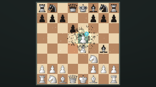

# Phase IV: cinematic capture effects

Starting source: `c7e384f826751019247d2c42dc109fb51e3bfb0c`, fetched on `architecture/effect-compositor`. Version remains **0.2.19**, project schema remains 2. No release/tag or published binary replacement is part of Phase IV.

## Features and controls

**Scene → Cinematic captures** adds an explicit enable switch, Subtle/Cinematic/Epic presets, intensity (0–2), amount (8–256 per capture, divided among particle layers), size (0.01–0.2 board units), spread (0.1–4), duration (0.2–3 seconds), spark/ring color and independent sparks/fragments/shockwaves/dust toggles. Reset restores disabled defaults. Old projects parse with this feature disabled. Existing per-move capture controls, dust exits, lighting, bloom and timing are preserved.

Three bounded Points batches draw additive impact sparks, square debris and soft drifting dust. Debris/dust sample colors from the captured artwork; these are colored billboard fragments, not fractured 3D meshes. One InstancedMesh draws up to 32 expanding additive shockwave rings, with intensity/decay reflected in ring color. Alpha fades quadratically. Sparks/debris/dust use analytic exponential drag; debris has a ballistic vertical term. All state is reconstructed from capture impact time (`depart + duration × capture.impact`), captured square, move index and absolute age. En passant uses the captured pawn's square. Effects can outlive a move and overlap subsequent captures; oldest excess particles are bounded by batch capacity rather than allocating objects indefinitely.

The system uses the existing board/world stage, before the world draw, with no new renderer or temporal simulation. Each particle batch has a fixed 1,536-particle capacity (4,608 total); ring capacity is 32. Particle attribute storage is about 144 KiB, plus ring attributes/geometry and driver overhead. Initialization is lazy; disabled/zero-intensity settings release the group and owned buffers, and allocate no GPU targets/textures. Scene disposal and graphics reconstruction include the new system. Capture objects opt into the existing `captures` bloom category.

## Confirmed bloom bug

The old mask branch hid every nonselected multi-material mesh, including actual chess pieces. It also hid transparent artwork faces. Selected particles behind pieces could therefore leak into the glow mask.

Nonselected piece meshes now retain geometry/material groups in the mask, using cached black depth-writing materials with borrowed artwork/alpha textures, original side/opacity and alpha-test cutouts. Crumble uniforms follow the source material. Source-material disposal releases cached masks and listeners; Scene disposal releases remaining masks. Material arrays and visibility restore after the mask, including errors. A real WebGL regression places a selected glow plane behind a two-material piece-like occluder: all glow must be blocked, then appear when the foreground is hidden. The cinematic goldens include piece-deselected bloom over actual game artwork and overlapping capture particles/highlights. Separate WebGL checks cover category-tagged trail/highlight geometry and dust-like Points behind the same foreground occluder.

The existing half-resolution blur/composite is retained; no additional bloom targets or speculative quality pipeline was added. Optional emissive glow for dark pieces was considered and deferred: this phase fixes occlusion and adds explicit bright capture sources. Dark pieces still use the existing brightness threshold. Transparent fading artwork is thresholded for depth occlusion, rather than modelling fractional light transmission; arbitrary transparent surfaces remain omitted from the mask.

## Regression protection and approval

- All **80 unit/service tests** pass in 12 files, preserving the previous 75.
- `npm run build` passes TypeScript, Vite and Electron compilation.
- `npm run test:render -- final`: **216 requests, 168 unique historical PNG fixtures**, exact hashes match the preserved Phase II baseline; zero tolerances.
- `node --import tsx scripts/cinematic-visual.ts`: **40 cinematic/bloom goldens** pass, with exact backward-seek, resize and independent preview/export RGBA equality for landscape, vertical, square and square-in-vertical.
- The shared browser hardening helper now reconstructs a Scene after `WEBGL_lose_context` while cinematic effects are enabled, reloads image assets, preserves project/time pixels, and checks disposal. This is simulated context loss, not a physical driver crash.
- `npm run test:desktop` passes Linux Electron editing, tooltips, save/open, bloom H.264/AAC export, all native-sized output formats, cancellation, dust/light/spotlight seek reconstruction and the presentation recovery button.
- Unit tests check legacy defaults/preset validation, analytic deceleration/replay, fixed capacities, lazy initialization, disposal on disable, multi-material mask depth and restoration. Existing render graph/resource/asset tests remain active.

The goldens were explicitly proposed and visually reviewed (including a contact sheet of all 40), then verified in normal comparison mode. See [golden approval instructions](cinematic-goldens/README.md). Default runs write candidate files only. CI compares both the historical baseline and the immutable approved cinematic source with the candidate using the same pinned Chromium. It generates browser-specific references only inside a separate temporary worktree, without editing the candidate's committed PNG/hash files. Updating `source-ref` requires an explicit reviewed source commit; it is never inferred from branch HEAD.

The pinned Chromium download failed in the cloud environment; local golden review uses installed Chromium 154/SwiftShader. CI installs Playwright Chromium and recomputes both approved-reference and candidate images with that same browser, avoiding cross-version PNG comparisons.

## Performance

Final measurements use Linux Chromium 154/ANGLE SwiftShader, three frames per configuration at a capture timestamp, no concurrent graphics test, with synchronous RGBA readback/copy included. First samples may include allocation/warm-up. Off means both cinematic captures and bloom disabled; on means both enabled with Cinematic settings. These are software-renderer frame latencies, not physical GPU/FPS measurements, and are not a matched before/after comparison against Phase III.

| Resolution | Off median | On median | Added time | Bloom target storage estimate |
| --- | ---: | ---: | ---: | ---: |
| 1920×1080 | 507.7 ms | 536.4 ms | 28.7 ms | 15.8 MiB |
| 3840×2160 | 1123.7 ms | 1283.4 ms | 159.7 ms | 63.3 MiB |

Three.js reported 17 off / 21 on texture objects. Cinematic batches add no textures; four bloom textures account for that difference. Geometry counts include lazily created existing game geometry, so they are not treated as exact VRAM usage. Target storage estimates exclude allocator overhead. Actual VRAM and physical GPU throughput are unmeasured. Disabled effects add an early CPU check and no new GPU allocation/draw; historical pixels remain exact, but a matched Phase III disabled-performance benchmark was not collected.

## Remaining limitations and next steps

Fragments are square billboards without rigid-body collisions; ring decay uses additive color rather than physical volumetric scattering. Dense simultaneous captures can reach fixed batch caps. Dark-piece emissive bloom, accurate fractional transparent occlusion, hardware GPU profiling and physical driver recovery remain future work. Presets apply at project level; legacy per-move capture settings continue to determine impact timing. Raw preview/export frames match at identical dimensions/time; H.264 is lossy, so decoded MP4 pixels are not claimed byte-identical to preview RGBA.

Hosted validation: https://github.com/understandingothers789-pixel/Chess-Animation-Studio/actions/runs/41400123467 . This is a push validation; release publication is disabled by the existing manual-dispatch condition.

The hosted extended Linux visual gate passed on implementation revision `3e987eb`, including the immutable cinematic source comparison. The subsequent final test-only occlusion assertions pass locally. The final hosted workflow is [41400911632](https://github.com/understandingothers789-pixel/Chess-Animation-Studio/actions/runs/41400911632) and was still running when this report was recorded; it is not claimed as complete.
