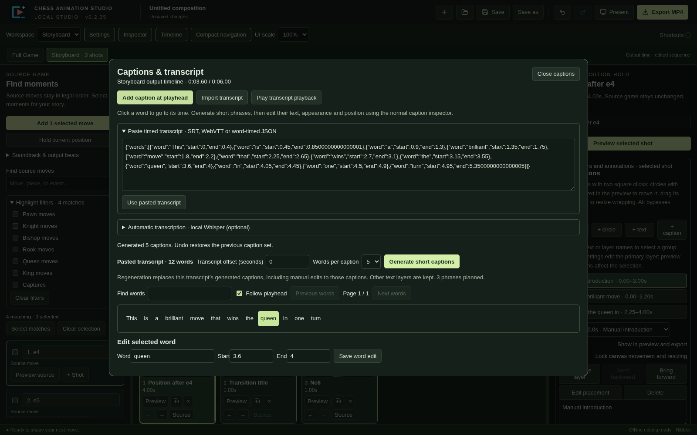
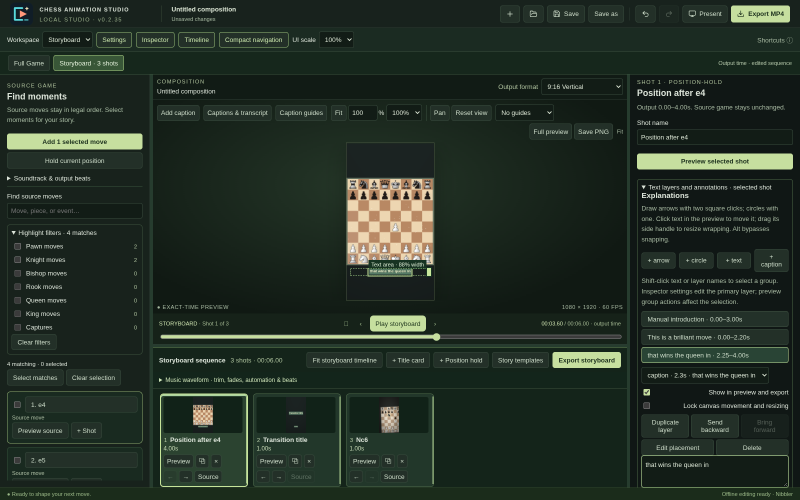

# Captions and transcript · 0.2.35

The app already supported manually styled text annotations and shot captions. This update adds a direct **Add caption** button, a timed transcript editor, short phrase generation and optional local speech recognition.

## Quick use

1. Open a composition and choose **Full Game** or **Storyboard**. **Add caption** creates a three-second caption at the playhead (clipped at the end of the current shot/timeline), selects it and focuses the existing text inspector.
2. Open **Captions & transcript**. Import a `.srt`, `.vtt` or timed `.json` file, or expand **Paste timed transcript**. The transcript belongs to the currently selected timeline.
3. Click a word to seek to its time. Use playback, search, follow-playhead and paging to navigate. Select a word to correct its text or start/end time and choose **Save word edit**.
4. Choose **Words per caption** (five by default) and **Generate short captions**. The phrases also break at sentence endings and pauses. They appear as ordinary editable caption layers and are burned into exported video.
5. Correct appearance, position and typography using the caption inspector. Regenerating replaces this transcript's generated captions, including edits to those captions; it preserves other manually created layers. Undo restores the previous set. Save the composition to retain transcript words and timings.

## Simple automatic transcription

In **Captions & transcript → Automatic transcription**, choose **Set up local transcription** on Windows x64. One-time setup downloads about 80 MB from GitHub, verifies both files and caches them in the app's user-data folder. There is no Python installation, API key, subscription or Hugging Face setup. Click **Import narration soundtrack**, then **Transcribe soundtrack locally**. Review the resulting words and generate captions.

Importing narration replaces the current soundtrack. This version uses the existing single soundtrack; it does not add a separate voiceover mixer track. FFmpeg must be available through the app's existing tool setting. The transcript offset starts at soundtrack offset minus source trim. After changing soundtrack alignment or storyboard timing, adjust the transcript offset and regenerate.

The bundled setup choice is the small English-only `tiny.en` model. It favors a quick setup and CPU recognition over maximum accuracy. An existing **whisper.cpp whisper-cli** executable and compatible GGML model can be selected manually, including multilingual models; the Python `whisper` command uses a different interface. On Linux/macOS, select an existing installation. Setup needs internet access to GitHub once; recognition then runs offline, without uploading audio. Cancel or close the dialog to stop an active task. Temporary converted audio and JSON are removed after success, cancellation or failure.

Downloads are pinned to [whisper.cpp v1.8.2](https://github.com/ggml-org/whisper.cpp/releases/tag/v1.8.2) and a [GitHub model mirror at an immutable commit](https://github.com/alex-vt/WhisperInput/blob/f0fb2a2822fa142d89ba37773f7a1b7f028901d1/app/src/main/assets/models/ggml-tiny.en.bin). Both tools/models are MIT licensed; links and hashes are recorded in the installed `SOURCES.txt`.

| Download | SHA-256 |
| --- | --- |
| whisper-bin-x64.zip | `b1514ebc099765e39fa37eb780b92a140a94c86bb0b3b3d98226b38825979732` |
| ggml-tiny.en.bin | `921e4cf8686fdd993dcd081a5da5b6c365bfde1162e72b08d75ac75289920b1f` |

The mirror's model also matches the official whisper.cpp model table's SHA-1 `c78c86eb1a8faa21b369bcd33207cc90d64ae9df`.

## Timing and editing limits

Word-timed JSON and local Whisper output provide word seeking. SRT/VTT imports provide cue times: every word in a cue seeks to that cue's start. Phrase timing within these cues is estimated, and the editor displays that distinction. Local recognition and word alignment can make mistakes; the editor lets you correct them. This is transcript navigation and caption generation, rather than transcript-based cutting of audio/video. It does not export a separate subtitle file or animate karaoke highlighting in the video.

Source captions and storyboard captions are independent tracks. Source text remains intact when generating storyboard captions. Output phrases split at shot boundaries into shot-local time; inherited generated source captions are suppressed on shots with an output-caption track, while manual inherited text remains available. Reordering or retiming shots after generation requires regenerating the output captions. Overlapping/equal-start word timings that cannot form separate phrases show an error rather than overlapping generated captions. Limits are 4 MB per transcript import, 50,000 transcript words, 5,000 source annotations and 2,000 annotations per shot.

## Validation

- The local suite passed: 171 tests passed, one existing conditional test skipped. Core tests cover word/cue parsing, timing provenance, short phrases, clipping/offsets, replacement ownership, project persistence, shot boundary splitting, inherited-caption deduplication and compiled-projection invalidation.
- Process-boundary tests cover argument handling (including paths with spaces), cancellation and temporary-file cleanup.
- Browser smoke covers direct caption creation, word seeking, generated-caption selection, Undo/Redo, native-shaped save/reopen, timing offset, search, word edits, cue warnings, replacement and narrow layout.
- A real CPU test with the official Whisper JFK speech sample recognized 22 timed words, including “Americans”, and produced five short phrases. No sample/model is included in the app package; setup downloads the model on request.
- Desktop UI/IPC validation used that same real sample: local recognition, five short captions, native project saving and timing/text persistence passed.
- Generated captions visibly changed compositor pixels. Four H.264/AAC exports (landscape and portrait at 24/30 FPS) passed decoded-frame comparisons; maximum mean absolute pixel error was 4.00/255. Soundtrack continuity, fades, missing-asset rejection, project roundtrip and cancellation cleanup passed.
- Packaged Windows validation exercises one-click setup and cache reuse, real speech recognition through the desktop bridge, short-caption generation through the UI, and native project saving. Its result and download are recorded after CI completes.
