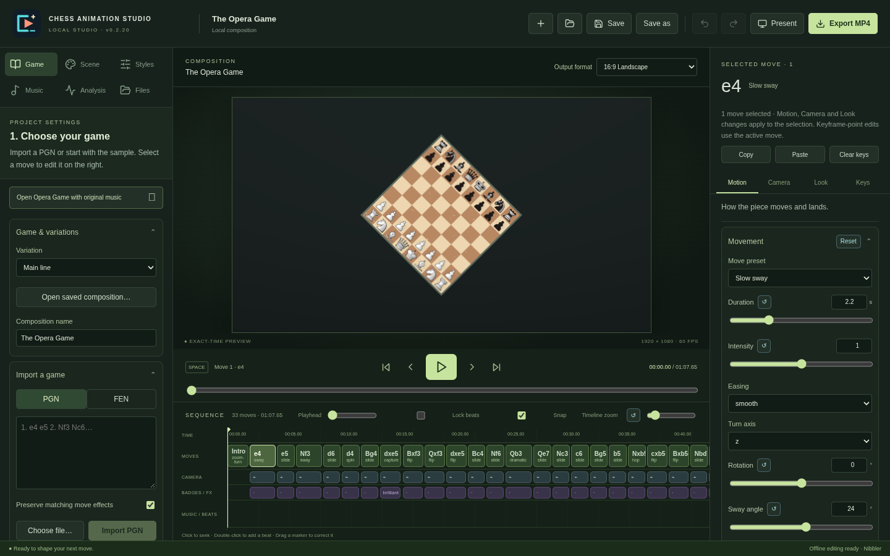
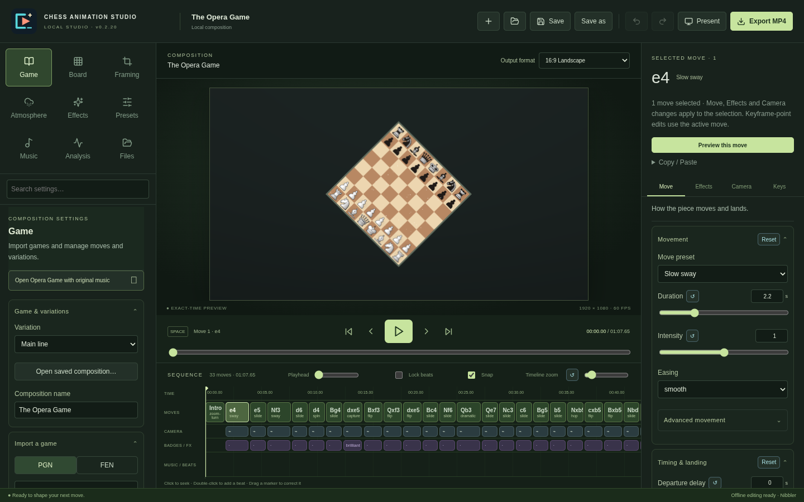

# Editor navigation and workflow redesign

Starting commit: `ead2febb2599fcd6e2fc62ac0b5bdbeed15bd4b7` on `architecture/effect-compositor` (fetched before editing).

The editor retains its two sidebars, dark green theme, preview, timeline, project format and renderer. The preview grid columns and dimensions are unchanged. No application version bump, release, or environment publication is part of this change.

## Organization

The left sidebar has nine 68-pixel navigation tiles in three columns and three rows: Game / Board / Framing; Atmosphere / Effects / Presets; Music / Analysis / Files. Icons sit above their labels. Arrow keys navigate the tiles; Tab, Enter and Space retain standard button behavior. Navigation stays visible while each category scrolls independently and retains its form and scroll state.

- Game retains imports, game management, moves and variations.
- Board contains piece artwork, square/rim/accent colors, orientation and coordinates.
- Framing contains output formats, background treatment, image import, background color, positioning, zoom and Shorts tracking/cropping.
- Atmosphere contains particles, rainbow cycles, board environmental animations and dark-square pulses.
- Effects contains Cinematic Captures and Bloom & Glow. Detailed cinema parameters have an optional Advanced section. Its shortcut opens the selected move's capture controls.
- Presets retains built-in and saved styles, explicit selected/checked/all scopes, and defaults for new imports.
- Music retains importing, timing arrangements, levels, markers and sound cues.
- Analysis retains Stockfish, evaluation, review colors and badges.
- Files retains tools, recovery, asset management and settings reports; badge artwork imports moved here.

Intro animation and timing are consolidated in the existing intro inspector, reached from Framing, Atmosphere or the timeline. Returning from the intro restores the previous move inspector tab.

## Inspector and workflow

The move inspector tabs are Move, Effects, Camera and Keys. Capture Impact moved from Motion into Effects alongside Beat Spotlight, light wash, highlights/trails and badges. Movement's intricate controls have an optional Advanced section. Key channels, curve editing and per-format camera controls remain available. Clear Keys lives in Keys; Copy/Paste is grouped under a secondary disclosure. Individual resets and undo/redo remain available.

Selecting captures offers a direct capture-effects action. The inspector preserves the user's tab and disclosures when moves change. Counts use valid selected move IDs. Numeric, choice, checkbox, text and color controls identify mixed values; edits still apply through the existing selection-aware edit/undo pipeline. Key-point editing remains explicitly scoped to the active move.

Effect section summaries expose Off, Enabled, Customized or Mixed states where appropriate. Global cinema is a separate layer triggered at each capture's per-move impact time; it does not override per-move capture parameters. Both sides provide navigation to the related controls.

Preview this move reuses the audio player, animation clock and exact-time preview. It begins at the move's segment start (including delay), covers its hold and capture/cinema tail within composition duration, and restores the captured playhead and paused/playing state. Restore timeline returns early; explicitly selecting or seeking elsewhere cancels the audition.

Settings search indexes mounted composition, intro and move controls. A result activates its category/tab, opens enclosing disclosures, scrolls to the control and focuses it. Enter opens the first result; Escape dismisses results. Controls rendered conditionally by an effect still appear in search only when that effect's conditional controls are available; search does not silently enable effects or modify project data.

## Screenshots

Captured at 1440×900 unless stated otherwise. These are UI captures with native file services stubbed; the preview uses the real WebGL renderer. Native services are covered separately by the desktop suite.

| Before | After |
| --- | --- |
|  |  |

Categories: [Board](board.png), [Framing](framing.png), [Atmosphere](atmosphere.png), [Effects](effects.png), [Presets](presets.png), [Music](music.png), [Analysis](analysis.png), [Files](files.png).

Additional views: [Selected-move inspector](inspector.png), [Intro inspector](intro.png), [1100×768 window](narrow.png).

## Validation

See `validation.md` for exact commands and results. `npm run test:ui` adds focused browser coverage for the nine tiles, project/settings preservation, multi-selection scope and mixed values, active summaries, manual tab persistence, preview restoration from paused and playing states, search reveal/focus, keyboard navigation, intro shortcuts and narrow layout.

The desktop script is adapted to the reorganized categories and inspector labels. Pixel checks wait for animation frames instead of assuming a fixed short delay guarantees a fresh frame on software WebGL.
