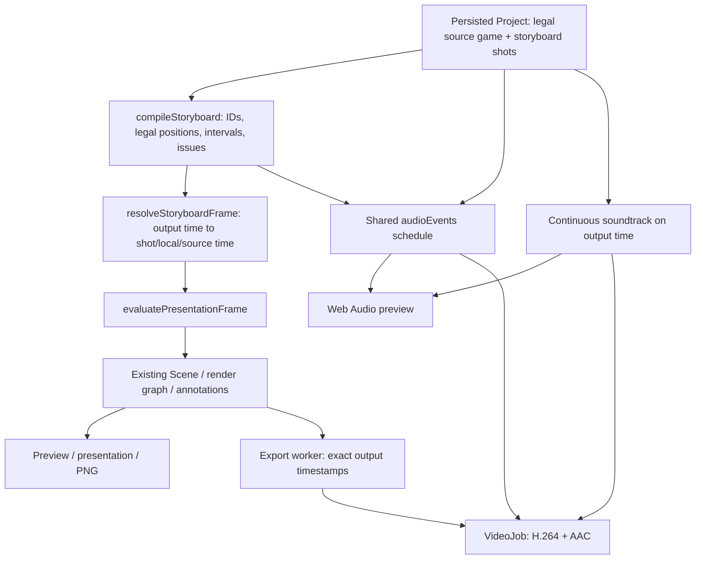

# Chess Animation Studio 0.2.30 — Engineering report

## A. Executive summary

This release adds an edited-sequence Storyboard workspace beside Full Game. Shots reference stable source move identities and can appear in any order, including repetitions. The source game remains legal and unchanged. Shots include move ranges, legal before/after position holds, and title cards; timing, trims, captions, annotations, camera, and animation settings are editable.

One resolver drives preview, presentation, PNG capture, and MP4 frames. The soundtrack advances on output time. Chess cues are mapped into each selected shot occurrence and clipped at cuts. This is an actual compositor/export implementation, not a visual-only card list.

## B. Git information

Repository: https://github.com/understandingothers789-pixel/Chess-Animation-Studio

Working branch: `architecture/effect-compositor`.

Starting HEAD: `fb7ab55bebadbf8ea5c3fe1a4e2a8fd4a49e0469` (0.2.29).

Final validated-build source: [`996d8c0ae0cc4f949396702e94e1f1a24e43d214`](https://github.com/understandingothers789-pixel/Chess-Animation-Studio/commit/996d8c0ae0cc4f949396702e94e1f1a24e43d214). Later commits contain documentation and validation evidence only; the final branch HEAD is provided in the completion message. No public release, PR, branch merge, reset, or force-push is part of this release.

- [`caef644`](https://github.com/understandingothers789-pixel/Chess-Animation-Studio/commit/caef644d576d4b34b3442c43acb0706339f3b2e9) — feat: add typed storyboard shots and deterministic source mapping
- [`5a03fb7`](https://github.com/understandingothers789-pixel/Chess-Animation-Studio/commit/5a03fb726de3d6265e6573e4cc3c37aabac3dcd9) — feat: evaluate storyboard cuts and legal holds through the shared renderer
- [`9915b16`](https://github.com/understandingothers789-pixel/Chess-Animation-Studio/commit/9915b165d333ffa3588eab690ad54f907d4c572d) — feat: map storyboard audio cues and export output timestamps
- [`53fbe59`](https://github.com/understandingothers789-pixel/Chess-Animation-Studio/commit/53fbe594856e0b8adf4b2ef711a468e9becea262) — feat: add the storyboard workspace, shot editing and chess storytelling tools
- [`edeb78d`](https://github.com/understandingothers789-pixel/Chess-Animation-Studio/commit/edeb78d295d8e6e4df33040ccd273d815ec8d486) — fix: preserve soundtrack fades, held-time mapping and resized caption textures
- [`b4f216d`](https://github.com/understandingothers789-pixel/Chess-Animation-Studio/commit/b4f216d20e0f6eefe316c121cbe8bab8429dae8e) — test: verify storyboard editing, decoded MP4 frames and packaged Windows workflow
- [`d858d14`](https://github.com/understandingothers789-pixel/Chess-Animation-Studio/commit/d858d14da1eac79300321682f6feb87a0d5c6af5) — fix: keep storyboard keyboard insertion synchronized with checked moves
- [`a08ad6d`](https://github.com/understandingothers789-pixel/Chess-Animation-Studio/commit/a08ad6d0343665bf4c5b1ee787edc2e25d54b657) — fix: complete shot preview and hold annotation behavior; provision CI video tools
- [`d00b45a`](https://github.com/understandingothers789-pixel/Chess-Animation-Studio/commit/d00b45a39f1a1d2b8e86386eb7aae71afbc74548) — fix: retain source framing and apply static shot cameras before cropping
- [`a37a92c`](https://github.com/understandingothers789-pixel/Chess-Animation-Studio/commit/a37a92c1ad5c9a9cd20b7aa136304d45146bdf3f) — ci: expose bounded packaged Windows smoke diagnostics in the run summary
- [`4e80f6a`](https://github.com/understandingothers789-pixel/Chess-Animation-Studio/commit/4e80f6a59ee305a648974084dbea88d3d75482ea) — test: await completed storyboard save before native reopen validation
- [`996d8c0`](https://github.com/understandingothers789-pixel/Chess-Animation-Studio/commit/996d8c0ae0cc4f949396702e94e1f1a24e43d214) — fix: reserve a usable preview in short windows and validate settled native frames

Protected refs below were verified unchanged after the implementation push:

| Ref | SHA |
| --- | --- |
| studio-main | `9e2eccc56e228fee5b526c9fc097316400c2ab08` |
| main | `e4ce9a7c61c250c6e1f84707d643da5942ea4cf7` |
| fresh-start | `5030ba80ff8444b312d775257319b594bf9b3fba` |
| windows-download | `6c185b473c2f4d855eb42517d1f8367d4edc8319` |

## C. Storyboard architecture

`Project.storyboard` persists only shots and output beat markers. A shot stores its ID, name, kind, source IDs, duration, trims, holds, optional camera/preset overrides, source-annotation inheritance, and local annotations. Old schema-2 projects receive an empty storyboard by default. Derived legal piece arrays and render state are not serialized into every shot.

`compileStoryboard` resolves IDs against the existing legal game and produces immutable derived shot projections. A move range begins from its exact legal source position and contains only its selected moves. A hold has no moves and uses the exact legal before/after piece array, preserving castling, promotion, en passant, and original piece identities. `@start` explicitly denotes the initial legal position. Missing IDs and invalid trims produce repair issues and block export rather than silently choosing another move.

The existing source evaluator and render graph remain the rendering implementation. The new presentation adapter chooses and projects the requested shot. Immutable snapshot caches retain compiled results; the source context cache is bounded to four entries.

## D. Time mapping

For a range with output start `O`, duration `D`, pre-hold `H0`, post-hold `H1`, and trimmed source interval `[A,B]`:

`local = clamp(output - O, 0, D)`

`source = A + clamp((local - H0)/(D - H0 - H1), 0, 1) × (B-A)`.

Example: a source range `[20,24]` becomes a six-second shot with one-second holds on each side. Output 0–1 holds source 20; output 3 resolves source 22; output 5–6 holds source 24. If a second, nonconsecutive source range `[3,5]` starts at output 6, output 7 resolves source 4. The source moves between those ranges are never played between the shots.

Repeating the first shot after the second gives the same legal pieces and source time at output 3 and output 11. Reverse mapping returns every range occurrence and the output intervals of matching held positions rather than pretending the mapping is one-to-one. Position holds remain constant legal states while their captions advance on local time.

Intervals are half-open at cuts; the exact final output time selects the final shot endpoint. Accumulation is rounded at nanosecond precision so `0.1 + 0.2` does not leave an erroneous preceding frame at the 0.3-second cut. Frame requests can arrive out of order without depending on previously rendered frames.

## E. Storyboard workspace

Choose **Storyboard** from the mode buttons or workspace preset. The left pane contains source discovery and selection. Add individual moments, the existing checked move selection, or the currently displayed legal position. Source timeline menus and the Game panel expose add actions. Full Game has its own source clock; changing modes restores the appropriate clock.

The central sequence contains rendered thumbnails and shot duration, preview, duplicate, remove, earlier/later, and source-navigation controls. Drag cards to reorder; use Alt+Left/Right, Ctrl/Cmd+D, and Delete from a focused card. Drag a duration edge or use the inspector for precise timing. A drag applies one history entry on completion. Templates and bulk insertion also use single transactions. Fit storyboard timeline exposes a proportional overview of the entire sequence, with direct shot navigation.

The right pane edits shot name, duration, holds, trims, source start/end, source repair, animation, camera, caption, and annotations. Shot settings do not overwrite the source move. Static holds retain the source game camera's framing mode, viewport and crop. Explicit hold camera overrides are applied before calculating Shorts cropping, so their zoom and position affect the actual projection. Missing references remain visible and can be relinked or removed.

## F. Highlight discovery

Filters use the existing legal-game classification: pawn, knight, bishop, rook, queen, and king moves; captures; checks; checkmates; promotions; castling. Additional filters expose already-completed analysis/book results and explicitly configured special animations or badges.

Multiple enabled filters form a union. Text search narrows the results. Matching moves display reasons and counts; Select matches adds to the checked selection without clearing prior choices. No heuristic guesses are presented as engine-backed sacrifices, brilliant moves, or winning tactics.

## G. Storytelling tools

Five templates create editable real shot structures: Puzzle Challenge, Opening Trap, Combination, Game Highlights, and Checkmate Reveal. The combination template deliberately uses neutral explanation prompts. Opening Trap requires setup and continuation selections; Checkmate Reveal requires a real selected mating move. Preview is non-mutating. Apply appends by default; replacement requires the explicit Replace existing storyboard option. One Undo reverses application.

Shot-local captions reuse the existing annotation schema and renderer. The inspector exposes text, start/end, entrance/exit, and the existing detailed annotation controls for font, size, placement, color, outline, shadow, arrows, and circles. Caption defaults differ for portrait versus landscape creation. Source annotations are excluded by default and included only through the explicit inheritance toggle. Inherited range timing is converted into the shot's clock. Position holds inherit only marks visible at their held source moment, keeping those marks for the shot's duration; the source annotations stay unchanged. Title cards use the same text renderer and omit board-only drawing controls.

## H. Preview

Play Storyboard follows output order with restart, previous/next, direct seeking, current shot, and output time/total duration. Both card Preview and inspector Preview selected shot play to the shot endpoint. Pausing that preview and choosing Play Storyboard clears the shot-only endpoint, so full-story playback continues across later cuts. The mode bar and transport explicitly distinguish source time from output time.

Cuts reconstruct the selected shot directly. Legal holds contain no replayed move animations or carried-over capture particles. The preview's PNG command and external presentation use the same resolver and Scene entry point as the export worker. Annotation context editing captures its intended shot/local time; opening viewing menus retains playback.

## I. Audio

The global soundtrack uses output time continuously and does not restart at cuts. Volume, mute, source trims, output offset, fades, and existing automation remain available. Storyboard output beats are separate from source beat markers and drive board pulses on the output clock. Source beat markers retain their existing Full Game meaning. The explicit Replace output beats with detected music beats action copies detected soundtrack timestamps into the output domain; importing new music clears stale output markers. Board-pulse enable and intensity controls are available alongside the soundtrack.

`audioEvents` provides the common preview/export schedule. It maps move, capture, knight, and manual source-linked cues only into shots that include their source move. Repeated shots get distinct occurrence IDs. Holds and titles do not replay chess sounds. Cues stop at shot/output boundaries; skipped source moves contribute no automatic sounds. Retiming shifts cue onset according to the visual mapping while preserving natural audio pitch and duration; there is no audio time stretching.

## J. Export

The export dialog distinguishes full composition, selected move, custom source range, and storyboard. It displays output mode, shot count, duration, resolution, frame rate, frame estimate, and repair/asset issues. The worker renders `start + frameIndex/fps` through the shared presentation evaluator; it does not render a continuous source game and hide unwanted portions.

All four existing output formats and appropriate Shorts framing use the same implementation at 24, 30, and 60 FPS. VideoJob encodes H.264 and mixes AAC using the common cue schedule and continuous output soundtrack. Startup validates references/assets, dimensions, range, and disk space. Cancellation tears down encoding and removes temporary output. Both UI/backend validation now use even dimensions from 64 through 4096; the inconsistent 3840 ceiling was removed.

## K. Screenshots

All 21 screenshots were visually reviewed. Review led to readable card action rows at 150% scale, horizontally scrollable tools in narrow windows, direct title text editing, and the caption texture resize correction.

Actual browser screenshots are recorded by `scripts/storyboard-ui-smoke.ts` under this directory. They show the running application, including rendered thumbnails, rather than mockups. The gallery includes empty/populated state, source insertion, discovery, reorder, inspector, caption, duration drag, hold, title, two template previews, playback, portrait/landscape, export, 1920-wide, 150% scale, and narrow layout.

- [Empty](01-empty.png), [populated](02-populated.png), [source insertion](03-add-source.png)
- [Discovery](04-highlight-discovery.png), [reorder](05-reordered.png), [inspector](06-inspector.png)
- [Caption](07-caption.png), [duration drag](08-duration-drag.png), [legal hold](09-position-hold.png), [title card](10-title-card.png)
- [Puzzle template](11-puzzle-template.png), [highlights template](12-highlights-template.png)
- [Playback](13-playback.png), [vertical](14-vertical.png), [landscape](15-landscape.png), [export](16-export.png)
- [1920](17-1920.png), [150% scale](18-scale150.png), [narrow](19-narrow.png)
- [Short Full Game window](20-short-full-game.png), [short Storyboard window](21-short-storyboard.png)

## L. Tests

Baseline before changes: 102 tests passed and one environment-dependent Stockfish test skipped; production build and timeline smoke passed.

Final local checks:

| Command | Result |
| --- | --- |
| `npm test` | 124 passed, no skips; 22 files passed after installing the local Stockfish validation binary (the earlier run had 123 passed and one environment-dependent skip) |
| `npm run build` | TypeScript, Vite production build, desktop/preload bundles passed |
| `DISPLAY=:106 npm run test:desktop` | Passed the complete development Electron native suite, including storyboard save/reopen, preview, real nonconsecutive MP4/AAC, cancellation, new project and presentation context recovery |
| `npm run test:ui` | Passed all existing navigation, editing, preview, search, keyboard, narrow-layout checks |
| `npm run test:creator` | Passed workspace/splitter persistence, PNG, preset/curve/clip Undo, captions, export settings, 900–1920 px and 100–150% scale |
| `npm run test:timeline` | Passed contextual editing/keyboard/viewport checks and 504 transformed board picks |
| `node --import tsx scripts/storyboard-ui-smoke.ts` | Passed real multi-selection keyboard insertion and one-step Undo, native drag/keyboard ordering, duplicate, captions/title editing, timing, holds, templates, playback, formats, save/reopen, source preservation; 21 screenshots, including both modes at 1100×700; no page errors |
| `node --import tsx scripts/storyboard-render-smoke.ts` | Passed fresh/reused renderer pixel equality, all 12 MP4 format/FPS combinations, every decoded frame, continuous AAC, fades/seek envelope, late soundtrack silence, missing assets/references and cancellation cleanup |
| `node --import tsx docs/storyboard-030/camera-check.mjs` | Passed all eight actual camera projection-matrix/position comparisons: inherited game framing and manual hold cameras across all four formats, including Shorts; [output](camera-check.txt) |
| `npm run benchmark:storyboard` | Measured 200-shot compilation/resolution/edit behavior; see section M |

`npm run test:storyboard` combines the two storyboard scripts above; CI runs this same command. The scripts were also rerun separately after the final fixes. The final selection, preview-resume, and shot-control fixes were additionally checked with a fresh production build and complete storyboard UI smoke. The last camera fix was followed by a full unit/build run and `npm run test:storyboard`; all 12 real export cases passed again. After the preview layout correction, the storyboard UI checks passed with 21 screenshots; the complete native desktop suite passed again, and creator/UI/timeline checks were rerun successfully. One local parallel run hit a menu-focus timeout; the unchanged timeline check passed on rerun and in the final CI gate.

Local native Electron smoke passed after configuring a temporary, unprivileged Xvfb display (`DISPLAY=:106 npm run test:desktop`). It exercised startup, source editing, 60 FPS H.264/AAC, caption exports at 24/30 FPS, native-sized output formats, cancellation, lighting/spotlight/dust seeking, presentation context recovery, storyboard editing/save/reopen/preview/nonconsecutive export/audio, and new-project creation. The temporary display was stopped after testing; [native test output](native-linux.txt) is retained. Packaged Windows CI passed for this exact source commit. The Linux gate now explicitly installs FFmpeg; earlier attempts stopped at the missing-tool check before native packaging. A later native smoke failure was reproduced locally: the test reopened immediately after clicking Save and raced the asynchronous write. The file held the correct new name once saving finished. The assertion is retained; validation now waits for the edited heading and the Unsaved → Saved UI confirmation before reopening. The complete local native suite then passed. Windows diagnostics also exposed comparisons of collapsed 2×2 previews. The layout now reserves preview space while the timeline shrinks and scrolls, and native pixel validation uses a consistent viewport, asserts meaningful canvas dimensions, and waits for settled frames. Strict pixel/content assertions remain intact. Windows failures now expose bounded diagnostic output in run annotations as well. The workflow also compares source render hashes against the verified Phase II reference and cinematic goldens; local browser interaction success is not substituted for that gate.

Final CI: **[Success — Windows portable build](https://github.com/understandingothers789-pixel/Chess-Animation-Studio/actions/runs/42336830877)**, source `996d8c0ae0cc4f949396702e94e1f1a24e43d214`.

- [Visual gate](https://github.com/understandingothers789-pixel/Chess-Animation-Studio/actions/runs/42336830877/job/128295525218): timeline interactions, all storyboard tests, decoded-frame/audio export checks, source render hashes, and cinematic goldens passed.
- [Packaged Windows gate](https://github.com/understandingothers789-pixel/Chess-Animation-Studio/actions/runs/42336830877/job/128297679991): build, unit/service tests, runtime signature check, startup, save/open, shot editing, preview, real nonconsecutive MP4/AAC, cancellation, and new-project checks passed. The portable artifact upload succeeded. Public release publication was skipped.
- [Artifact metadata](ci-validation.json) records the verified names, IDs and digests, including the Windows validation evidence.

New coverage includes persisted shot schema, missing IDs/repair, reorder/duplicate, time mapping/boundaries/retiming/repetition, legal castling/promotion/en passant/holds, render-frame parity, annotation isolation, source preservation, output beats, mapped audio cue occurrence/clipping, real template structures, chess filters, save/reopen, interaction history, and actual video encoding.

The headless render smoke creates a project containing reordered nonconsecutive moves, a legal hold, and a title card, writes/reopens it through the desktop file service, renders through Scene, encodes through the real VideoJob, decodes every frame, and compares pixels to the preview renderer. It tests all 12 format/FPS combinations, continuous AAC across cut timestamps, missing-source rejection, cancellation, and temporary-file cleanup. Packaged Windows smoke additionally exercises native IPC and the actual export worker.

## M. Performance

Local CPU benchmarks: 200 shots from a 33-move source. Two measured runs gave cold compilation of 34.95–82.60 ms; 10,000 resolves took 8.72–14.11 ms total; recompilation after a name-only immutable edit took 0.68–1.23 ms. Concurrent validation load affects these measurements. They are specific to this execution environment and are not a GPU frame-rate claim.

Across the 12 final encoded-video cases, maximum mean absolute decoded RGB error versus its exact compositor frame was 7.10/255 at the deliberately small 90–160 px test sizes (asserted below 14/255 for every frame). The expected H.264 color/subsampling loss does not alter the mapped frame order. Renderer reuse after caption/thumbnail resizing matched a fresh renderer exactly before encoding.

Thumbnails are generated only for intersecting cards while paused, using one idle queue borrowing the existing preview renderer. The visible preview is restored after each snapshot. A resizing regression check compares a reused renderer with a fresh renderer pixel for pixel. It caught stale captions from immutable GPU texture storage; annotation textures now reallocate when their dimensions change. The cache holds at most 48 images. Legal fallback diagrams are shown while actual images prepare. No thumbnail creates its own WebGL renderer. Source game/camera evaluation is shared across presentation-only changes, and repeated frame requests reuse compiled immutable snapshots.

## N. Known limitations

Direct cuts are supported. Dissolves, audio time stretching, automatic tactical narration, and automatic highlight scoring are intentionally deferred. Captions inherit the annotation renderer's font/format controls; a long sentence may need manual line breaks or size adjustment. Templates provide editable prompts and require the creator to supply factual commentary. Asset validation conservatively includes project assets, including unused missing assets.

Local GPU tests use software Chromium, not a physical Windows graphics driver or microphone. The packaged Windows suite uses software rendering and passed; physical Windows GPU/driver combinations and microphone hardware were not manually tested in this run.

## O. Future recommendations

1. Add waveform-backed soundtrack editing directly beside the output shot sequence.
2. Offer per-format caption placement presets and automatic safe-area line wrapping.
3. Support optional source-audio versus continuous-output music policies per shot.
4. Add engine-backed highlight suggestions with transparent provenance and confidence.
5. Add carefully tested dissolves and per-shot visual keyframe overrides without changing source moves.

## P. Final status

**Fully implemented and verified within the automated local and packaged Windows coverage described above.**

- Version: **0.2.30**.
- Validated source: `996d8c0ae0cc4f949396702e94e1f1a24e43d214` on `architecture/effect-compositor`.
- [Windows portable download](https://github.com/understandingothers789-pixel/Chess-Animation-Studio/actions/runs/42336830877/artifacts/13560720389) — verified artifact **13560720389**, **168 MB**, retained for 90 days; GitHub sign-in is required.
- Artifact digest: `sha256:8fbafd291fcb2ca9038ed1cfcaa4dcda69e8a231a01cff2e99034a18c6b40872`.
- [Successful CI run](https://github.com/understandingothers789-pixel/Chess-Animation-Studio/actions/runs/42336830877). Local unit/service checks: **124 passed, no skips**; native desktop and storyboard/video/audio checks passed.
- Source game order is preserved. The protected branches remain unchanged. No public GitHub release was published.

The README download uses the same bold blue-link convention as previous versions. Advanced transitions, audio stretching and the recommendations in section O are outside this completed release scope.
